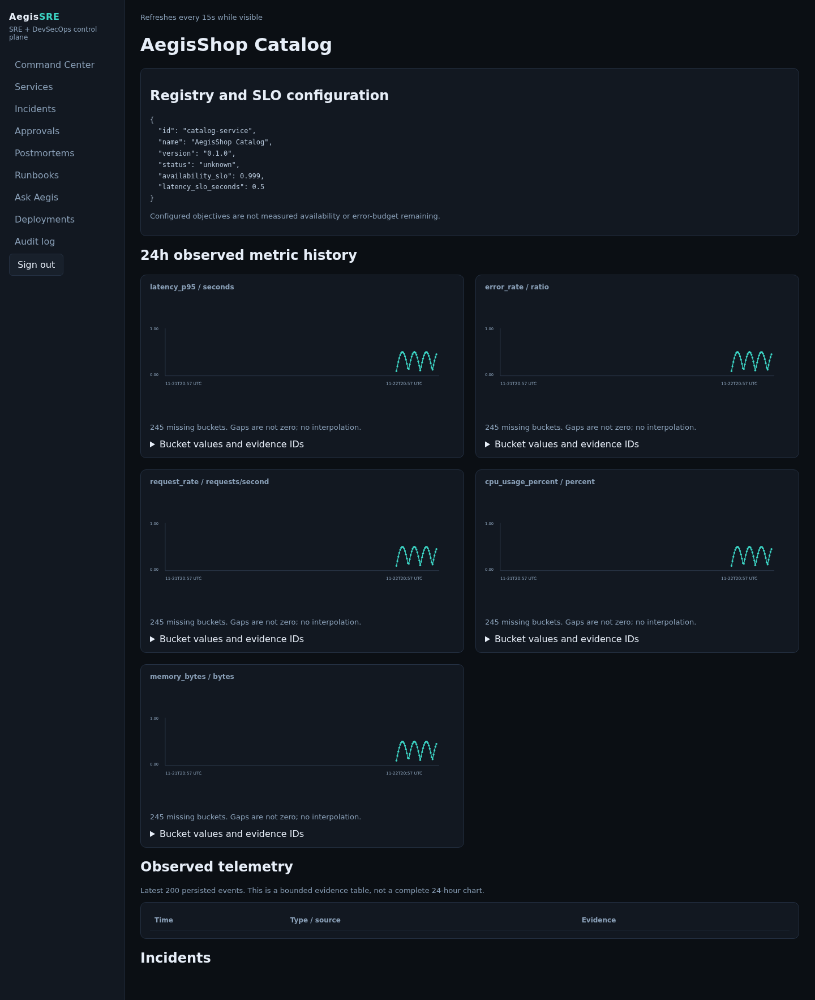

# Observed history chart visual check

Actual local Next production build at 1440x1000 against an explicitly synthetic
HTTP fixture, not real telemetry. Sparse fixture points fill only the final few
hours, leaving the rest of the 24h axis empty. No invented zero-fill line joins
that missing interval. Inspected all five metric panels, labels, units, legends,
registry configuration and expandable evidence-table controls. No clipping.

The API's own actual Prometheus/PostgreSQL/gateway proof is a separate required
hosted check. This screenshot is visual evidence only. Red incident-interval
bands are labeled as incident context, not ground-truth anomaly onset. Actual
anomaly windows and measured SLO budget/burn panels remain unfinished.

