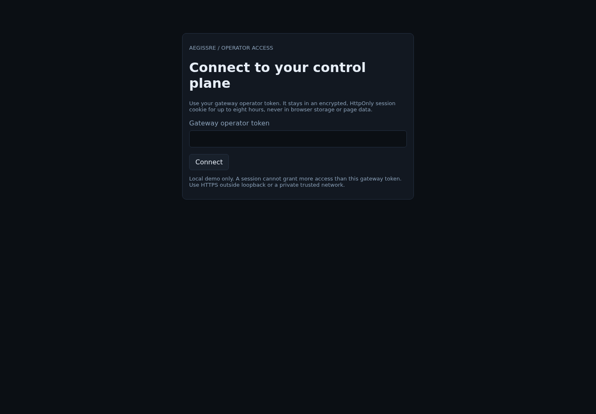
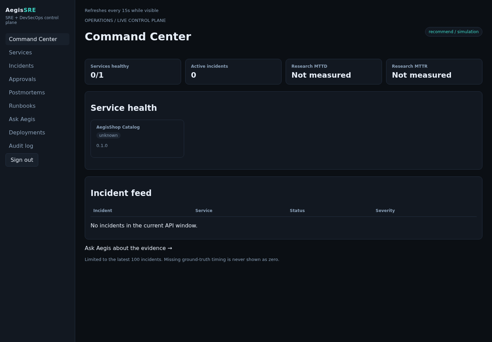

# Console foundation visual checks

These are actual rendered pixels from the local Next production build. The API
was an explicitly synthetic HTTP fixture with one unknown-health service and no
incidents. They are visual/layout evidence only, not real platform-data or
acceptance evidence. No user credentials appear. Inspected at1440x1000: login
form, typography, sidebar, empty states, mode and unknown/not-measured values.

