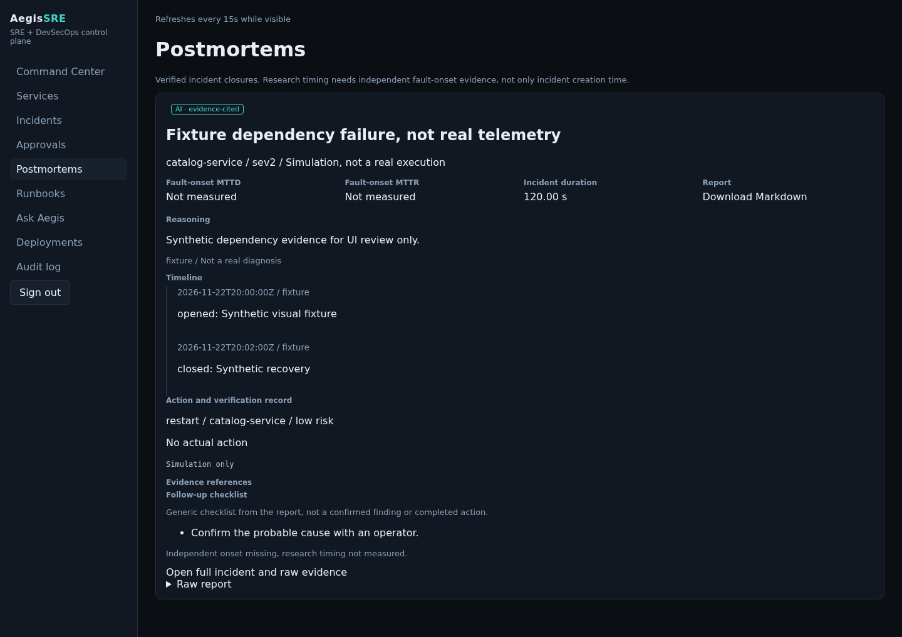
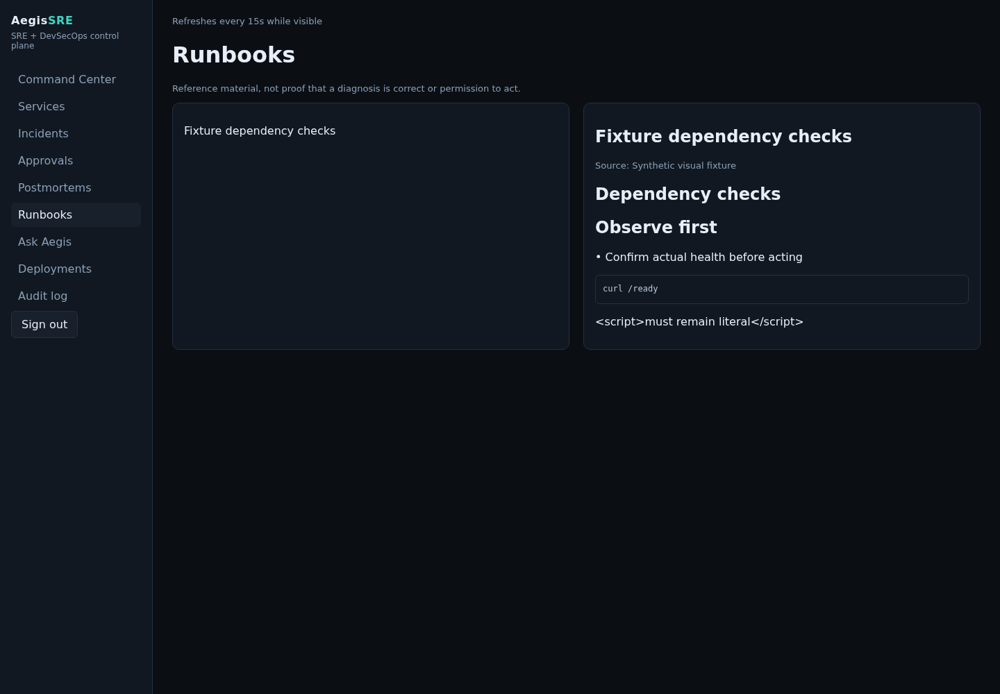

# Console reports and runbooks

The images below are actual rendered pixels from the local Next production build
at 1440x1000. The HTTP API was an explicitly synthetic fixture, not the running
AegisSRE platform. The report is labeled as a fixture and a simulated action.
It has no independent fault-onset time, so research MTTD and MTTR remain
"Not measured" while the separate incident duration is shown.

The browser check followed an incident's retrieved runbook link, rendered a
text-only Markdown subset, downloaded the authenticated Markdown report, and
checked that raw HTML remains text. These prove local rendering and interaction,
not real-fault accuracy, model reasoning, actual recovery, or full C1 acceptance.
The full-stack gateway checks remain a separate required gate.

Inspected: report timing, timeline, reasoning, action, checklist and export link;
runbook headings, code block, source and literal HTML. No clipping in these
views. No user credentials appear.

