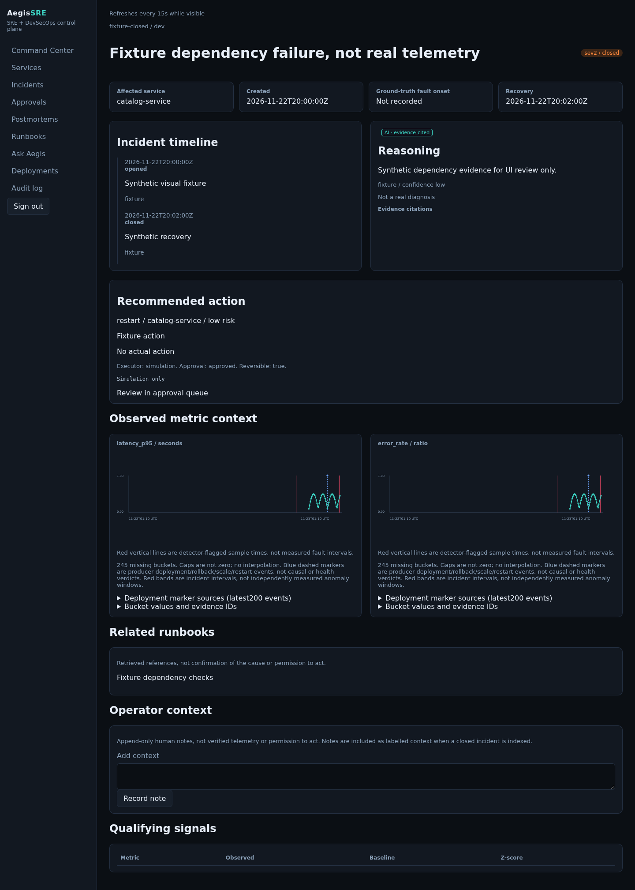

# Operator note form

Actual Next console rendered from the explicitly synthetic local API fixture.
The inspected image shows the bounded operator-context form and its unverified
context label. This is not real fault or recovery evidence.

